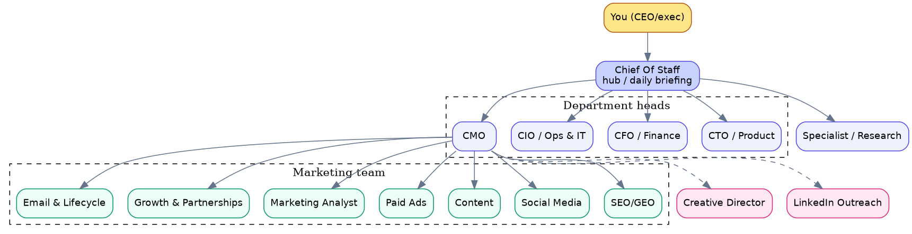

# Grok Bot Executive Team

**An AI executive team in Grok Bot for a CEO or exec running one company or team: a Chief Of Staff hub, department heads, a marketing team, and the rules they all work by.**



Inspired by [Tim Scheuer's grokbot-gtm-team](https://github.com/timscheuerai/grokbot-gtm-team). Built by Lev Group.

**[Create the team in 1 prompt](setup-prompt.md)** · [The team](#the-team) · [The rules](guides/rules.md) · [Multi-project mode](#multi-project-mode-optional)

## Set up the team

1. Create a new bot in Grok Bot and call it **Chief Of Staff**.
2. Paste the prompt from [setup-prompt.md](setup-prompt.md) into its chat.
3. Answer its one question: **one company, or several projects?** It builds the matching structure and the routines.
4. Connect tools in settings. Each bot's file lists the connectors it may use.

Nothing is sent or spent during setup. Every file in [agents/](agents/) also has the block to paste by hand.

## The team

| Bot | Job | Reports to |
|---|---|---|
| You (CEO/exec) | Sets goals, approves anything irreversible | |
| [Chief Of Staff](agents/01-chief-of-staff.md) | The hub. Routes work, writes the daily briefing, sends everything as drafts. | You |
| [CTO / Product](agents/02-cto.md) | Roadmap and code via cloud agents, staging first. | Chief Of Staff |
| [CFO / Finance](agents/03-cfo.md) | Costs split per department or project; monthly expense report on the 1st. | Chief Of Staff |
| [CIO / Ops & IT](agents/04-cio.md) | Infra, domains and DNS on Vercel, keys, vendors, internal tools. | Chief Of Staff |
| [CMO](agents/05-cmo.md) | Leads the marketing team. | Chief Of Staff |
| [SEO/GEO](agents/06-seo-geo.md) | Search ranking and visibility in AI answers. | CMO |
| [Social Media](agents/07-social-media.md) | Social channels, post drafts, calendar. | CMO |
| [Content](agents/08-content.md) | Blog, landing page and long-form copy. | CMO |
| [Paid Ads](agents/09-paid-ads.md) | Ad campaigns and budgets, drafts only. | CMO |
| [Marketing Analyst](agents/10-marketing-analyst.md) | Funnel and campaign metrics, mostly from PostHog. | CMO |
| [Growth & Partnerships](agents/11-growth-partnerships.md) | Partnerships, referrals, growth experiments. | CMO |
| [Email & Lifecycle](agents/12-email-lifecycle.md) | Onboarding, newsletters and lifecycle sequences. | CMO |
| [Creative Director](agents/13-creative-director.md) | Visual identity, design assets, brand consistency. | CMO (dotted line) |
| [LinkedIn Outreach](agents/14-linkedin-outreach.md) | LinkedIn prospecting and message drafts. | CMO (dotted line) |
| [Specialist / Research](agents/15-specialist-research.md) | One narrow research job, e.g. building a directory from public sources. | Chief Of Staff |

## How the work flows

```text
You (CEO/exec)        goals and approvals; you send what bots draft
  |
Chief Of Staff        routes every request to one owner; daily briefing, decisions on top
  |
  +-- Department heads    CTO/Product (staging first) · CFO/Finance · CIO/Ops & IT · CMO
  |     +-- CMO team      SEO/GEO · Social · Content · Paid Ads · Analyst · Growth · Email
  |     :.. dotted line   Creative Director · LinkedIn Outreach
  +-- Specialist bots     one narrow job, e.g. research / directory enrichment
  |
Drafts back to you    nothing irreversible happens without your explicit OK
```

## Routines

| Routine | When | Who |
|---|---|---|
| Daily briefing: what's going on, what's next, decisions at the top, 5 growth ideas | Sun-Fri ~8am, skipping Shabbat | Chief Of Staff, combined from each department head |
| Monthly expense report, per department or project | 1st of each month | CFO |

## Multi-project mode (optional)

Running several projects or business units? Add one **Project CEO** bot per project ([agents/optional-project-ceo.md](agents/optional-project-ceo.md)). Each reports to Chief Of Staff with a daily status, next moves and 5 growth ideas, and the daily digest combines their reports, with decisions from every project at the top. The department heads stay shared. Details: [guides/multi-project-mode.md](guides/multi-project-mode.md).

## License

[MIT](LICENSE).
