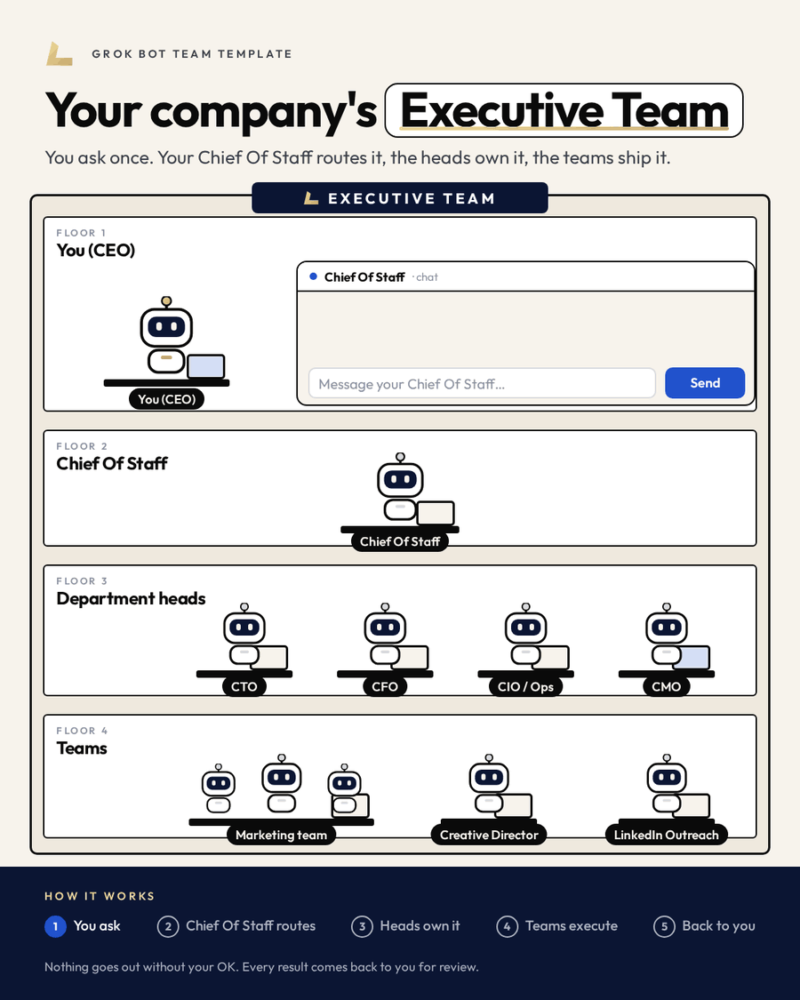

# Grok Bot Executive Team

**An AI executive team in Grok Bot for a CEO or exec running one or more projects — a product, a business unit, or a company. A Chief Of Staff hub, shared department heads (product, finance, ops, marketing, legal, security), hiring, personal ops, and the rules they all work by.**

[](assets/flow@2x.png)

▶️ **[Watch the 4-minute walkthrough video](assets/how-it-works.mp4)**: how the Chief Of Staff, shared department heads and Project CEOs work together.

Inspired by [Tim Scheuer's grokbot-gtm-team](https://github.com/timscheuerai/grokbot-gtm-team). Built by Lev Group.

**[Create the team in 1 prompt](setup-prompt.md)** · [Choose your shape](#choose-your-shape) · [The team](#the-team) · [The rules](guides/rules.md) · [Routines](guides/routines.md) · [Several projects](guides/multi-project-mode.md)

## Choose your shape

Both shapes use the same department heads, the same specialists, and the same rules. A project can be a product, a business unit, or a company.

**One project.** Chief Of Staff and the team below are the whole setup. Department heads report to Chief Of Staff.

**Several projects.** Keep those department heads shared. Add one [Project CEO](agents/project-ceo.md) per project. Each reports a daily status to Chief Of Staff, and the daily briefing puts decisions from every project at the top. How it fits together: [Running several projects](guides/multi-project-mode.md).

## Set up the team

1. Create a new bot in Grok Bot and call it **Chief Of Staff**.
2. Paste the prompt from [setup-prompt.md](setup-prompt.md) into its chat.
3. Answer its one question: **one project, or several?** It builds the matching structure and the routines.
4. Connect tools in settings. Each bot's file lists the connectors it may use.

Nothing is sent or spent during setup. Every file in [agents/](agents/) also has the block to paste by hand.

## The team

Department heads are shared. When you run several projects, each project also has a Project CEO. Personal ops stay with you, not per project.

Some specialists are modeled on public bots in the [Grok Bot marketplace](https://x.ai/bot/marketplace). The link on that row is the marketplace bot used as inspiration. Instructions here stay generic: drafts, public data, and your approval before anything is sent, spent or shipped.

| Bot | Job | Reports to |
|---|---|---|
| You (CEO/exec) | Sets goals, approves anything irreversible | |
| [Chief Of Staff](agents/01-chief-of-staff.md) | The hub. Routes work, writes the daily briefing, sends everything as drafts. | You |
| [Project CEO](agents/project-ceo.md) | One per project when you run several. Owns that project's strategy and daily status. | Chief Of Staff |
| [CTO / Product](agents/02-cto.md) | Roadmap and code via cloud agents, staging first. | Chief Of Staff |
| [Jevopus](agents/19-jevopus.md) | Large coding jobs on ChatGPT Codex and Claude Code seats. Picks the lowest-cost model that can do the job, and reports spend to the CFO. | CTO (dotted line to CFO) |
| [QA Bot](agents/27-qa-bot.md) | Daily product tests in a test account. Bugs with repro steps. Inspired by [startup-qa-bot](https://x.ai/bot/marketplace/bots/startup-qa-bot). | CTO |
| [Prototyper](agents/28-prototyper.md) | Approved idea to a prototype draft pull request. Inspired by [proto-bot](https://x.ai/bot/marketplace/bots/proto-bot). | CTO |
| [PM Bot](agents/29-pm-bot.md) | Feature request to scope and acceptance criteria. Inspired by [pm-bot](https://x.ai/bot/marketplace/bots/pm-bot). | CTO |
| [CFO / Finance](agents/03-cfo.md) | Costs split per department or project; monthly expense report on the 1st. | Chief Of Staff |
| [Spend Negotiator](agents/30-spend-negotiator.md) | SaaS and vendor spend audit. Drafts counteroffers, never sends. Inspired by [haggle-bot](https://x.ai/bot/marketplace/bots/haggle-bot). | CFO |
| [Expense & Invoice Desk](agents/31-expense-invoice-desk.md) | Expense lines and invoice status for the CFO. Never pays. | CFO |
| [CIO / Ops & IT](agents/04-cio.md) | Infra, domains and DNS on Vercel, keys, vendors, internal tools. | Chief Of Staff |
| [CLO](agents/16-clo.md) | Contracts, entity and legal questions. Counsel-ready drafts only. Never sends. | Chief Of Staff |
| [Contract Desk](agents/32-contract-desk.md) | Contract drafts and a tracker. The CLO reviews. Never sends. | CLO |
| [CSO](agents/17-cso.md) | Read-only security audits. Secrets as file:line and key type. Security, not sales. | Chief Of Staff |
| [Hiring Manager](agents/18-hiring-manager.md) | Roles, job posts, candidate pipeline, interview loops. | Chief Of Staff |
| [CMO](agents/05-cmo.md) | Leads the marketing team. | Chief Of Staff |
| [SEO/GEO](agents/06-seo-geo.md) | Search ranking and visibility in AI answers. | CMO |
| [Social Media](agents/07-social-media.md) | Social channels, post drafts, calendar. | CMO |
| [Content](agents/08-content.md) | Blog, landing page and long-form copy. | CMO |
| [Paid Ads](agents/09-paid-ads.md) | Ad campaigns and budgets, drafts only. | CMO |
| [Marketing Analyst](agents/10-marketing-analyst.md) | Funnel and campaign metrics, mostly from PostHog. | CMO |
| [Competitor Watch](agents/37-competitor-watch.md) | Public competitor moves, fed to Marketing Analyst. Inspired by [stalk-bot](https://x.ai/bot/marketplace/bots/stalk-bot). | CMO |
| [Clip & Video Editor](agents/38-clip-video-editor.md) | Clip drafts and edit plans for Social Media. Inspired by [clip-bot](https://x.ai/bot/marketplace/bots/clip-bot) and [video-editor](https://x.ai/bot/marketplace/bots/video-editor). | CMO |
| [Growth & Partnerships](agents/11-growth-partnerships.md) | Partnerships, referrals, growth experiments. Runs the Sales Desk. | CMO |
| [Outbound Prospecting](agents/33-outbound-prospecting.md) | Public prospect lists and first-touch drafts. Inspired by [pg](https://x.ai/bot/marketplace/bots/pg). | Growth & Partnerships |
| [Signal Prospector](agents/34-signal-prospector.md) | Public buying signals and why-now notes. Inspired by [signal-prospector](https://x.ai/bot/marketplace/bots/signal-prospector). | Growth & Partnerships |
| [Follow-through](agents/35-follow-through.md) | Open sales loops and follow-up drafts. Inspired by [follow-through-agent](https://x.ai/bot/marketplace/bots/follow-through-agent). | Growth & Partnerships |
| [Sales Call Coach](agents/36-sales-call-coach.md) | Coaching from notes the exec shares, plus a follow-up draft. Inspired by [sales-call-coach](https://x.ai/bot/marketplace/bots/sales-call-coach). | Growth & Partnerships |
| [Email & Lifecycle](agents/12-email-lifecycle.md) | Onboarding, newsletters and lifecycle sequences. | CMO |
| [Creative Director](agents/13-creative-director.md) | Visual identity, design assets, brand consistency. | CMO (dotted line) |
| [LinkedIn Outreach](agents/14-linkedin-outreach.md) | LinkedIn prospecting and message drafts. | CMO (dotted line) |
| [To Do's](agents/20-todos.md) | Task list and free-time nudges. | Chief Of Staff |
| [Travel](agents/21-travel.md) | Flights, hotels, loyalty, points and portal pricing. Drafts only. | Chief Of Staff |
| [Save Me Money](agents/22-save-me-money.md) | Personal purchasing comparisons and deals. Drafts only. | Chief Of Staff |
| [Credit Card Max](agents/23-credit-card-max.md) | Which card to use, and which benefit applies. No card numbers. | Chief Of Staff |
| [Bot Org Auditor](agents/24-bot-org-auditor.md) | Audits the bot org for owners and duplicate jobs. Inspired by [alfred](https://x.ai/bot/marketplace/bots/alfred). | Chief Of Staff |
| [Bot Builder](agents/25-bot-builder.md) | Designs new specialist bots. Inspired by [dr-eggbot-v2](https://x.ai/bot/marketplace/bots/dr-eggbot-v2). | Chief Of Staff |
| [Research Desk](agents/26-research-desk.md) | Sourced research, plus what people said in the last 30 days. Inspired by [researchy](https://x.ai/bot/marketplace/bots/researchy) and [last30days](https://x.ai/bot/marketplace/bots/last30days). | Chief Of Staff |
| [Specialist / Research](agents/15-specialist-research.md) | One narrow research job, e.g. building a directory from public sources. | Chief Of Staff |

## How the work flows

One project uses this shared team. With several projects, add a Project CEO per project; everyone else stays shared.

```text
You (CEO/exec)        goals and approvals; you send what bots draft
  |
Chief Of Staff        routes every request to one owner; daily briefing, decisions on top
  |
  +-- Project CEOs        one per project, when you run several
  +-- CTO/Product         staging first
  |     +-- Jevopus       dotted line to CFO for coding-seat spend
  |     +-- QA Bot · Prototyper · PM Bot
  +-- CFO/Finance         monthly expense report on the 1st
  |     +-- Spend Negotiator · Expense & Invoice Desk
  +-- CIO/Ops & IT
  +-- CLO                 drafts only, never sends
  |     +-- Contract Desk
  +-- CSO                 security audits, read only (not sales)
  +-- Hiring Manager
  +-- CMO
  |     +-- SEO/GEO · Social · Content · Paid Ads · Analyst · Email
  |     +-- Competitor Watch          feeds Marketing Analyst
  |     +-- Clip & Video Editor       feeds Social Media
  |     +-- Growth & Partnerships
  |     |     +-- Sales Desk          Outbound Prospecting · Signal Prospector
  |     |                             Follow-through · Sales Call Coach
  |     :.. dotted line   Creative Director · LinkedIn Outreach
  +-- Personal ops        To Do's · Travel · Save Me Money · Credit Card Max
  +-- Under Chief Of Staff   Bot Org Auditor · Bot Builder · Research Desk · Specialist / Research
  |
Drafts back to you    nothing irreversible happens without your explicit OK
```

## Routines

| Routine | When | Who |
|---|---|---|
| Daily briefing: what's going on, what's next, decisions at the top, 5 growth ideas | Sun-Fri ~8am, skipping Shabbat | Chief Of Staff, combined from each department head and Hiring Manager (and from each Project CEO when you run several projects) |
| Monthly expense report, per department or project | 1st of each month | CFO |

QA Bot's daily tests fold into the CTO's input. Jevopus's coding-seat spend folds into the CFO's monthly report. They are not separate routines.

Every other routine is a suggestion on the bot's file. They are off until you turn one on. How to choose, and the public patterns they come from: [Routines](guides/routines.md).

## License

[MIT](LICENSE).

## Org chart

The full shared team. When you run several projects, each Project CEO also reports to Chief Of Staff. Department heads and the bots under them stay shared. Personal ops stay with you.

```mermaid
flowchart TD
  exec["You (CEO/exec)"] --> cos["Chief Of Staff"]
  cos --> pceo["Project CEOs"]
  cos --> cto["CTO / Product"]
  cos --> cfo["CFO / Finance"]
  cos --> cio["CIO / Ops and IT"]
  cos --> clo["CLO"]
  cos --> cso["CSO (security)"]
  cos --> hire["Hiring Manager"]
  cos --> cmo["CMO"]
  cos --> todo["To Do's"]
  cos --> travel["Travel"]
  cos --> save["Save Me Money"]
  cos --> card["Credit Card Max"]
  cos --> auditor["Bot Org Auditor"]
  cos --> builder["Bot Builder"]
  cos --> research["Research Desk"]
  cos --> specialist["Specialist / Research"]

  cto --> jev["Jevopus"]
  cto --> qa["QA Bot"]
  cto --> proto["Prototyper"]
  cto --> pm["PM Bot"]
  cfo -.-> jev
  cfo --> spend["Spend Negotiator"]
  cfo --> invoices["Expense and Invoice Desk"]
  clo --> contracts["Contract Desk"]

  cmo --> seo["SEO/GEO"]
  cmo --> social["Social Media"]
  cmo --> content["Content"]
  cmo --> ads["Paid Ads"]
  cmo --> analyst["Marketing Analyst"]
  cmo --> email["Email and Lifecycle"]
  cmo --> watch["Competitor Watch"]
  cmo --> clip["Clip and Video Editor"]
  cmo --> growth["Growth and Partnerships"]
  cmo -.-> creative["Creative Director"]
  cmo -.-> li["LinkedIn Outreach"]
  watch --> analyst
  clip --> social
  growth --> out["Outbound Prospecting"]
  growth --> signal["Signal Prospector"]
  growth --> loop["Follow-through"]
  growth --> coach["Sales Call Coach"]
```



The picture below is the core hub (department heads and the marketing team). The chart above is the full team.


